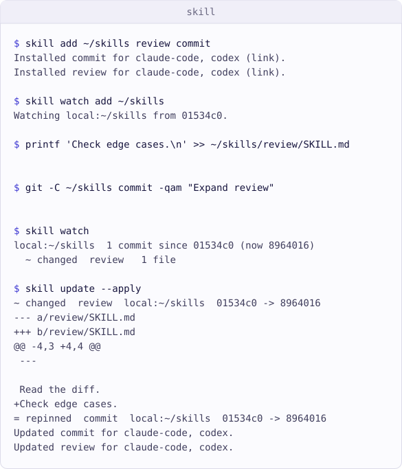

<p align="center">
  <a href="https://github.com/skill-cli/cli">
    <picture>
      <source media="(prefers-color-scheme: dark)" srcset="Documentation/Assets/Logo.png">
      
    </picture>
  </a>
</p>

<h1 align="center">skill</h1>

<p align="center">
  A package manager for agent skills.
</p>

<p align="center">
  <a href="https://github.com/skill-cli/cli/actions/workflows/ci.yml"></a>
  <a href="Package.swift"></a>
  <a href="Package.swift"></a>
  <a href="LICENSE"></a>
</p>

<p align="center">
  <a href="#overview">Overview</a> ·
  <a href="#quick-look">Quick look</a> ·
  <a href="#install">Install</a> ·
  <a href="#usage">Usage</a> ·
  <a href="#requirements">Requirements</a> ·
  <a href="#documentation">Documentation</a> ·
  <a href="#contributing">Contributing</a> ·
  <a href="#license">License</a>
</p>

## Overview

Declare skills once, restore exact locked content with `install`, and preview
upstream changes before applying an update. `skill` supports Codex, Claude Code,
Cursor, Gemini CLI, and OpenCode through
[agents-tools/core](https://github.com/agents-tools/core).

This is the skills edition of [agents](https://github.com/agents-tools/cli).
`skill add|list|remove|update|init` matches `agents skills` commands;
`skill install|update|doctor` runs the shared skill operations. Instruction
selections, locked instruction records, and target files remain untouched.
`skill watch` matches `agents watch` and shares its subscription state,
including reports of instruction units and well-known artifacts.

## Quick look

Install two skills from a local Git source, watch it for changes, and apply an
upstream update:

<p align="center">
  <picture>
    <source media="(prefers-color-scheme: dark)" srcset="Documentation/Assets/Demo/Demo-dark.svg">
    
  </picture>
</p>

## Install

Install the latest stable release from the Homebrew tap:

```sh
brew install skill-cli/tap/skill-cli
skill --help
```

For a development build of `master`, use:

```sh
brew install --HEAD skill-cli/tap/skill-cli
```

The tap provides `skill` and `swift-skill`. Use either executable directly;
`swift skill` depends on the active Swift driver's external-command dispatch.
See the [tap documentation](https://github.com/skill-cli/homebrew-tap#readme)
for packaging and channel details. This checkout documents the 0.3 command
surface; the stable tap may still distribute 0.2 until 0.3 is released.

## Usage

```sh
skill add https://github.com/anthropics/skills.git --all --agent codex
skill list
skill list --scope user --json
skill watch add https://github.com/anthropics/skills.git
skill watch
skill watch diff https://github.com/anthropics/skills.git
skill watch seen https://github.com/anthropics/skills.git
skill install
skill update
skill update pdf --apply
skill remove pdf
skill init my-skill
skill doctor --root /path/to/project-a /path/to/project-b --json
```

Project scope uses the current directory and stores `agents.json`,
`agents.resolved`, `agents.watch`, and `cache/` under `.agent/`. `--scope user`
uses `~/.agents/`. Keep state and caches out of version control.

`add` installs in `link` mode for the recipients already recorded for that skill
or source, otherwise for the declaration's default agents (initially Codex and
Claude Code). Repeat `--agent` to choose recipients. `link` and `copy` install
committed, pinned content from Git sources; `edit` links a live local directory.
An unnamed add installs the only discovered skill or prints choices when there
are several. `--all` follows future membership changes on update.

`watch` subscribes without installing content, reports changes since the last
`watch seen`, and previews file differences. `watch remove` keeps installed
skills and instructions. Scheduling checks is left to the caller.

Commands are non-interactive. Updates preview by default; `--apply` prints the
differences before writing. See the
[CLI reference](Documentation/Reference/CLI.md) for options, JSON schemas,
errors, and exit codes.

### Upgrading from 0.2

0.3 uses the shared `agents.json` declaration and `agents.resolved` lock in
project `.agent/` or user `~/.agents/`. It does not read 0.2 state files.
Add sources again with `skill add`; skill names are positional arguments.
0.2 watch ledgers and the `review` commands are gone: watch is now a
subscription. Subscribe again with `skill watch add` and acknowledge changes
with `skill watch seen`.

### Companion skill

Install the companion that teaches agents this command surface:

```sh
skill add skill-cli/cli --branch master --path skills/skill-cli --scope user --agent codex
```

For live local development:

```sh
skill add . --path skills/skill-cli --scope user --agent codex --mode edit
```

## Requirements

- macOS 13 or later
- Swift 6.3 or later to build from source
- Git for source repositories

## Documentation

- [Documentation index](Documentation/README.md)
- [CLI reference](Documentation/Reference/CLI.md): commands, options, output,
  state, and JSON schemas
- [Package architecture](Documentation/Architecture/Package.md): ownership and
  data flow
- [Releasing skill](Documentation/Reference/Release.md): dependency, version,
  and release checks

## Contributing

Read [Contributing](CONTRIBUTING.md) for change guidelines and the full
validation loop. The [development section](#development) gets a local build
running.

### Development

```sh
swift build
swift run skill --help
```

The package consumes core's `master` branch during development. Release
preparation changes this to a published version range. The build-time version
is `BuildInfo.version` in `Sources/CLI/EntryPoint.swift`.

## License

`skill` is available under the [MIT License](LICENSE).
